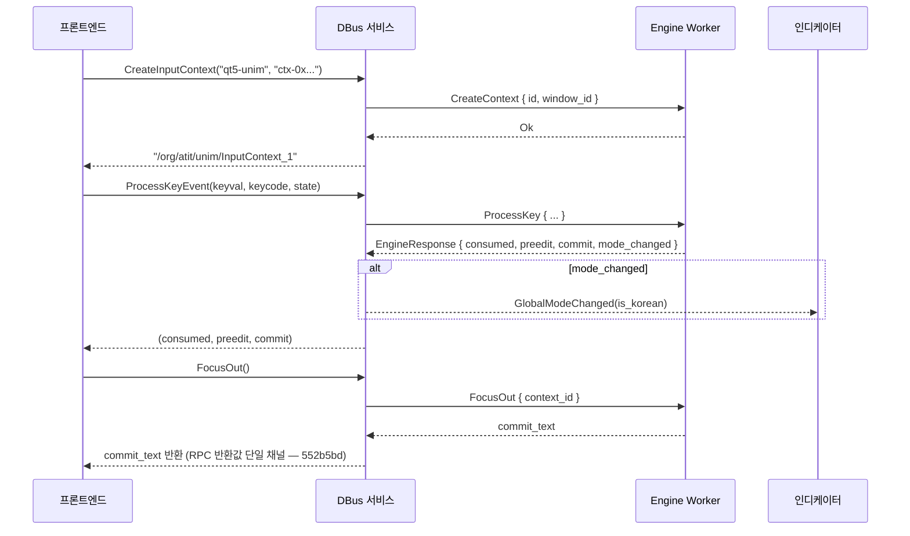

# UNIM DBus IPC 라이브러리 세부 기능 명세

> `unim-dbus`는 프론트엔드(GTK/Qt/XIM/Wayland)와 입력 엔진 사이의 DBus 기반 프로세스 간 통신(IPC)을 담당하는 라이브러리입니다.
> 서버 측 서비스 구현과 클라이언트 프록시를 모두 제공합니다.

---

## 1. 아키텍처 개요

### 1.1 컴포넌트 구성

| 파일 | 바이트 | 역할 |
|------|--------|------|
| `lib.rs` | 808 | 모듈 선언 + DBus 상수 (버스 이름, 경로) |
| `interfaces.rs` | 1,598 | 공유 데이터 타입 (`PreeditText`, `InputMode`) |
| `service.rs` | 21,376 | 서버 측 DBus 인터페이스 구현 |
| `engine_worker.rs` | 12,366 | 엔진 전용 스레드 (블로킹 워커) |
| `client.rs` | 3,289 | 클라이언트 프록시 (`zbus::proxy` 매크로) |

### 1.2 전체 통신 구조

```
┌──────────────┐   DBus (Session Bus)   ┌──────────────────────────────────────┐
│  프론트엔드  │ ←──────────────────→ │           unim-daemon 프로세스        │
│ (GTK/Qt/XIM) │   메서드 호출/시그널  │                                      │
└──────────────┘                       │  ┌─────────────┐   mpsc   ┌────────┐ │
       │                               │  │ DBus 서비스 │ ──────→ │ Engine │ │
       │ client.rs                     │  │ (tokio 런타임)│ ←────── │ Worker │ │
       │ (zbus proxy)                  │  └─────────────┘ oneshot  │(별도   │ │
       │                               │                           │ 스레드)│ │
       └───────────────────────────────│                           └────────┘ │
                                       └──────────────────────────────────────┘
```

### 1.3 의존성

| 크레이트 | 버전 | 용도 |
|----------|------|------|
| `unim` | (로컬) | 코어 입력 엔진, 설정, 키코드 |
| `zbus` | 4.x (tokio) | DBus 비동기 통신 |
| `tokio` | 1.x | 비동기 런타임 (rt-multi-thread, sync) |
| `serde` | 1.x | 직렬화/역직렬화 |

---

## 2. DBus 상수 및 경로

```rust
// lib.rs
pub const BUS_NAME: &str = "org.atit.unim.InputMethod";
pub const INPUT_METHOD_PATH: &str = "/org/atit/unim/InputMethod";
pub const INPUT_CONTEXT_PATH_PREFIX: &str = "/org/atit/unim/InputContext_";
```

| 항목 | 값 | 설명 |
|------|-----|------|
| 버스 이름 | `org.atit.unim.InputMethod` | 세션 버스에 등록되는 서비스 이름 |
| 서비스 경로 | `/org/atit/unim/InputMethod` | InputMethod 팩토리 객체 |
| 컨텍스트 경로 | `/org/atit/unim/InputContext_{id}` | 컨텍스트별 동적 생성 |

---

## 3. 공유 데이터 타입 (`interfaces.rs`)

### 3.1 PreeditText

```rust
pub struct PreeditText {
    pub text: String,          // 조합 중인 문자열
    pub cursor_pos: u32,       // 커서 위치 (바이트 단위)
    pub visible: bool,         // 화면 표시 여부
}
```

### 3.2 InputMode

```rust
pub enum InputMode {
    Korean,    // 한국어 모드
    English,   // 영어 모드
}
```

`unim::config::InputCategory`와 양방향 변환 (`From` trait):
- `InputCategory::Korean` ↔ `InputMode::Korean`
- `InputCategory::English` ↔ `InputMode::English`

---

## 4. 서비스 아키텍처 (`service.rs`)

### 4.1 스레딩 모델

`InputEngine`은 `Send + Sync`를 구현하지 않으므로, DBus 서비스와 엔진은 **별도 스레드**에서 실행됩니다.

```
tokio 런타임 (멀티 스레드)          전용 std::thread
┌───────────────────────┐          ┌─────────────────────┐
│ InputMethodService    │  mpsc    │ Engine Worker       │
│ InputContextHandler   │ ──────→ │                     │
│                       │ oneshot  │ contexts: HashMap   │
│  (async DBus 핸들러)  │ ←────── │ (blocking_recv 루프)│
└───────────────────────┘          └─────────────────────┘
```

- **mpsc::channel(256)**: DBus → 엔진 요청 전송 (비동기 → 블로킹)
- **oneshot::channel**: 각 요청에 대한 1회성 응답 채널

### 4.2 EngineRequest (요청 프로토콜)

```rust
pub enum EngineRequest {
    ProcessKey { context_id, keyval, keycode, state, response },
    CreateContext { id, window_id, response },
    DestroyContext { id, response },   // 응답: 팝업이 열려 있었는가(bool)
    FocusIn { context_id, window_id, response },
    FocusOut { context_id, response },
    Reset { context_id },
    SetGlobalMode { is_korean },
    GetHanjaCandidates { context_id, response },   // 응답 (HanjaCandidateResponse, closed_popup: bool)
    SelectHanja { context_id, index, response },   // 응답 SelectHanjaOutcome {None, Commit, Replace, ReplaceSurrounding}
    CancelHanja { context_id },
    SetClientCapabilities { context_id, caps },    // 응답 없음 — 대상③ 능력 비트
    SurroundingHint { context_id, kind, keyval, state }, // 응답 없음 — 엔진 밖 사건(키·포인터·PRIMARY·선택 불명)
    CancelEmojiPopup { context_id, committed, response }, // committed=true 면 문서 낡음 표시
}
```

### 4.3 EngineResponse (응답 프로토콜)

```rust
pub struct EngineResponse {
    pub consumed: bool,              // 키 소비 여부
    pub preedit: Option<String>,     // 변경된 preedit (None이면 변경 없음)
    pub commit: Option<String>,      // 커밋할 텍스트 (None이면 없음)
    pub mode_changed: Option<bool>,  // 모드 변경 시 is_korean (None이면 변경 없음)
    pub replace_surrounding: Option<ReplaceSurrounding>, // 대상③ 확정 — {delete_before, delete_after, commit_text, expect_text}
    // (그 밖 popup_action·auto_typefix·render_state·chord_pending·atf_* 필드는 코드 참조)
}
```

### 4.4 InputContext 직렬 디스패치 (zbus 4.4 반전 속성 주의)

`org.atit.unim.InputContext` 인터페이스(`InputContextHandler`)는 **메서드별 태스크를 만들지 않고 연결의 디스패치 루프에서 직렬로 처리**한다. 데몬의 버스 연결은 1개라 **모든 앱의 InputContext 호출이 전역으로 직렬**이며, 같은 컨텍스트에서 응답 없이 보낸 `SetSurroundingText` 가 뒤따르는 `GetHanjaCandidates`/`ProcessKeyEvent` 보다 **먼저 엔진 채널에 들어가야** 하기 때문이다(HANJA_WORD_SPEC §2.4.5 순서 불변식 — 별도 태스크면 도착 순서가 뒤집혀 낡은 선택으로 한자 대상이 잡힌다).

- 속성: `#[interface(name = "org.atit.unim.InputContext", spawn = true)]`. **zbus_macros 4.4.0 `iface.rs:377` 의 `spawn` 은 반전**되어(`!spawn.unwrap_or(false)`) `spawn = true` 일 때 메서드별 태스크가 **꺼진다**(`spawn_tasks_for_methods() == false`). 지정 안 함·`spawn = false` 는 태스크 생성(켜짐). zbus 5.x 는 `unwrap_or(true)` 로 정상 방향이라, 5 로 올릴 때는 `spawn = false` 로 바꿔야 한다. 단위 시험 `unim-dbus/tests/surrounding_order.rs` 가 `spawn_tasks_for_methods()` 를 단언해 방향 변경을 드러낸다.
- `org.atit.unim.InputMethod` 는 직렬화하지 않는다 — `set_config`·`set_global_mode`·`register/unregister` 가 RwLock write 와 파일 I/O 를 하므로 그 자리에서 실행하면 InputContext 까지 막는다.
- 비용: InputContext 호출이 처리되는 동안 같은 연결의 다른 메시지 디스패치가 늦어진다(엔진이 단일 스레드라 실제 지연 증가는 미미).
- 후속 과제(이번 범위 밖): IBus 호환 `org.freedesktop.IBus.InputContext`(`ibus_compat/ibus_context.rs:187`)도 메서드별 태스크라 같은 도착 순서 경쟁이 있다. IBus 경로에 응답 없는 선행 송신 → 후속 조회 패턴이 생기면 같은 방식(zbus 4.4 반전 `spawn = true`)으로 직렬화를 검토한다.

---

## 5. InputMethod 인터페이스 (`org.atit.unim.InputMethod`)

경로: `/org/atit/unim/InputMethod`

### 5.1 메서드

| 메서드 | 파라미터 | 반환 | 설명 |
|--------|----------|------|------|
| `CreateInputContext` | `client_name: s, window_id: s` | `s` (경로) | 입력 컨텍스트 생성 + DBus 등록 |
| `SetGlobalMode` | `is_korean: b` | — | 전역 입력 모드 변경 |
| `GetGlobalMode` | — | `b` | 현재 전역 모드 조회 |
| `GetConfig` | `key: s` | `s` | (legacy) 키 단위 설정 조회 — 프론트엔드 호환용 |
| `SetConfig` | `key: s, value: s` | — | (legacy) 키 단위 설정 변경 + 저장 + 시그널 |
| `GetConfigYaml` | — | `s` | 전체 Config를 YAML 문자열로 반환 (파일 포맷과 동일) |
| `GetConfigJson` | — | `s` | 전체 Config를 JSON 문자열로 반환 (JS 친화) |
| `SetConfigYaml` | `yaml: s` | — | YAML 파싱 → `clamp_ranges()` → 저장 → `ConfigChangedJson` 방출 |
| `RegisterFrontend` | `name: s` | — | **등록형 서비스 목록**에 이름 추가 (멱등). 호출자 unique name 을 등록자로 기록(§5.5). IM 프런트엔드 레지스트리가 아님 |
| `UnregisterFrontend` | `name: s` | — | **호출자 자신의** 등록만 제거, 등록자가 없어진 이름은 목록에서 빠짐 (없으면 no-op). §5.5 |
| `GetActiveFrontends` | — | `as` | 현재 등록된 이름 목록 조회 (정렬됨) |
| `TypeFix` | `direction: u` | `(i, u, s)` | 글로벌(InputContext 비보유) 수동 TypeFix. direction: 0=자동,1=영→한,2=한→영. 반환 (offset_from_cursor, delete_chars, replacement) — 호출자(현재 GNOME extension)가 직접 삭제/커밋 수행 |
| `AddReverseUserDictWord` | `word: s, note: s` | `b` | 역방향 AutoTypeFix 억제 사전에 단어 추가 (영문 알파벳만) |
| `RemoveReverseUserDictWord` | `word: s` | `b` | 역방향 사전 단어 제거 |
| `ListReverseUserDictWords` | — | `a(ssu)` (단어, 메모, 등록시각) | 역방향 사전 전체 조회 |
| `UpdateReverseUserDictWord` | `word: s, note: s` | `b` | 역방향 사전 단어의 메모 갱신 |
| `RegisterUserDictFromSelection` | — | `s` | 마지막 selection surrounding text를 역방향 사전에 등록 |
| `GetEmojiRecent` | — | `as` | 최근 사용 이모지 목록 조회 |
| `TriggerAction` | `action: s` | — | 글로벌 트리거(InputContext 비보유, KDE/Hyprland 단축키 도구·`unim-cli trigger` 등). 지원: `"emoji_popup"`, `"notify_test"` — §5.6 참조 |
| `SetEmojiCategory` | `idx: u` | — | **internal-only** — popup-service forward 전용. 외부 frontend는 `org.atit.unim.Popup::SetEmojiCategory` 사용 |
| `CommitEmoji` | `emoji: s` | — | 글로벌 이모지 커밋 (InputContext 비보유 경로) |

### 5.2 시그널

| 시그널 | 파라미터 | 발생 조건 |
|--------|----------|-----------|
| `GlobalModeChanged` | `is_korean: b` | 모드 변경, FocusIn, ProcessKey 모드 변경 |
| `ConfigChanged` | `key: s, value: s` | (legacy) SetConfig 호출 시 |
| `ConfigChangedJson` | `json: s` | SetConfigYaml 호출 시 전체 Config JSON payload |
| `ActiveFrontendsChanged` | `names: as` | RegisterFrontend/UnregisterFrontend 로, 또는 등록자 소멸(`NameOwnerChanged`, §5.5)로 등록형 서비스 목록이 실제로 바뀔 때만 (no-op 재호출은 미발행) |
| `Notify` | `kind: s, title: s, body: s, duration_ms: u, flags: u` | 상황 알림(토스트) 표시 요청. 알림 전담 태스크가 **`gnome-shell-notify` 등록자가 1명 이상일 때만** 발행하고, 없으면 데몬이 `org.freedesktop.Notifications` 를 직접 호출한다(시그널 미발행). `kind` 는 snake_case 이벤트 종류(`atf_corrected_forward`·`atf_corrected_reverse`·`atf_suppressed`·`blacklist_learned`·`password_enter`·`password_leave`·`mode_toggle_suppressed`·`mode_changed`·`feature_toggled`, 테스트 액션은 `test`). `flags`: 0x01=text_shown(`notify.show_text` 로 입력 텍스트 포함 — 수신측 로그 금지), 0x02=replace(직전 알림 교체). `title`/`body` 는 데몬이 `engine.notify.language` 로 렌더링한 완성 문구이며 **로그에 남기지 않는다**(`kind` 만). 설계 [`NOTIFY_SPEC.md`](../docs/dev/specs/NOTIFY_SPEC.md) §3.2 |

### 5.3 CreateInputContext 상세

```
CreateInputContext("qt5-unim", "qt5-ctx-0x...")
  → 1. context_counter 원자적 증가 → id 생성
  → 2. 경로 생성: "/org/atit/unim/InputContext_{id}"
  → 3. window_id가 빈 문자열이면 client_name으로 대체
  → 4. EngineRequest::CreateContext → 엔진 워커에 전송
  → 5. InputContextHandler를 해당 경로에 DBus 등록
  → 6. 호출자 unique name(메시지 헤더 sender)을 컨텍스트 소유자로 기록 (§5.3a)
  → 7. 경로 문자열 반환
```

### 5.3a 입력 컨텍스트 회수 (연결 종료)

클라이언트가 `Destroy` 없이 죽으면 컨텍스트가 영원히 남아(CI 실측 create 428 / destroy 76) 전역 모드
전파 루프(ATF 전파·토글 전파·`SetGlobalMode`)가 살아 있는 컨텍스트 수만큼 돈다. 이를 막기 위해
데몬이 소유자의 연결 종료를 감시해 컨텍스트를 회수한다. 구현은 `src/context_registry.rs`.

- **키**: 컨텍스트를 만든 호출자의 **unique name**(`:1.N`) → 컨텍스트 id 집합(`OwnerMap`).
  `org.atit.unim.InputMethod.CreateInputContext`, IBus 호환 `org.freedesktop.IBus.CreateInputContext`,
  포털 `org.freedesktop.IBus.Portal.CreateInputContext` 세 생성 경로가 모두 `#[zbus(header)]` 의
  sender 를 기록한다. IBus 호환 레이어는 별도 연결 없이 데몬과 **같은 세션 버스 연결**을 쓰므로
  동일하게 동작한다. 레지스트리(`ContextRegistry`)는 `InputMethodService` 가 소유하고 IBus 호환
  레이어와 `InputContextHandler`/`IBusInputContextHandler` 가 핸들을 공유한다.
- **감시**: 프런트엔드 등록자 감시(§5.5)와 **같은** `NameOwnerChanged` 구독
  (`spawn_frontend_watcher`)을 재사용한다. `:` 로 시작하는 unique name 의 `new_owner` 가 비면
  그 owner 의 컨텍스트를 전부 회수한다(프런트엔드 등록 여부와 무관).
- **공통 경로**: 회수와 명시적 `Destroy`(UNIM·IBus 양쪽)는 `destroy_context` 하나를 탄다 —
  레지스트리 제거 → `last_active` 캐시 무효화(해당 path 일 때) → `EngineRequest::DestroyContext`
  (per-context 엔진 상태와 알림 게이트의 비밀번호 칸 기록 정리) → 팝업(한자·특수문자·이모지)이
  열려 있었으면 그 컨텍스트 path 로 `HidePopup` 발행(UNIM 컨텍스트만 — 앱이 팝업을 연 채 죽어도 창이
  남지 않게. 열려 있지 않으면 내지 않는다: 경로 무관 구독자가 다른 앱의 팝업을 닫지 않게) →
  object_server 에서 핸들러 제거.
- **멱등·경합**: owner 의 id 는 맵에서 한 번만 꺼내지고, 엔진 `HashMap::remove` 는 이미 없어도 오류가 아니고
  `ObjectServer::remove` 의 `InterfaceNotFound` 는 버리므로 `Destroy` 와 경합하거나 같은 owner 가 두 번 통지돼도 이중 파괴·패닉이
  없다. `Destroy` 된 컨텍스트는 레지스트리에서 빠지므로 회수 대상이 아니다.
- **생성 직후 경합 방어**: 등록 직후 `NameHasOwner(sender)` 로 소유자 생존을 한 번 확인하고, 이미
  죽었으면 즉시 회수한다(응답 전에 죽으면 `NameOwnerChanged` 가 등록보다 먼저 도착하기 때문).
- **회수 대상에서 제외되는 경우**: sender 가 없는 p2p 연결(주로 시험용 `UnixStream::pair`)은
  버스가 없어 `NameOwnerChanged` 를 낼 수 없으므로 추적하지 않는다. 실제 데몬은 항상 버스 연결이다.
- **한계**: 컨텍스트를 만든 연결이 살아 있는 한 회수되지 않는다(다른 연결이 대신 종료돼도 무관).
  살아 있으나 응답하지 않는 클라이언트의 컨텍스트도 회수되지 않는다. 감시는 `with_notify` 로 켜지며
  데몬 `main` 은 항상 호출한다.
- **로그**: 회수 시 `연결 종료 :1.N — 컨텍스트 K개 회수: ids=[...]` 형식으로 개수와 id 만 남긴다
  (사용자 텍스트·창 제목 평문 금지, HANJA_WORD_SPEC §2.8).

### 5.4 설정 키 매핑

legacy `GetConfig`/`SetConfig` 디스패치에서 인식하는 키. YAML/JSON 엔드포인트
(`GetConfigYaml` / `SetConfigYaml` / `GetConfigJson`)는 serde로 전체
`Config` 구조체를 자동 처리하므로 **신규 필드 추가 시 여기 5.4 표만 갱신**하면 된다.

| 키 | 타입 | 유효값 / 구조체 경로 |
|----|------|--------|
| `korean_layout` | enum | `Dubeolsik`, `Sebeolsik390`, `Sebeolsik391`, `SebeolsikNoShift` |
| `english_layout` | enum | `Qwerty`, `Dvorak`, `Colemak`, `ColemakDh`, `Workman` |
| `default_category` | enum | `Korean`, `English` |
| `mode_sharing` | enum | `Global`, `PerApp`, `PerWindow` |
| `toggle_keys` | string list | 쉼표 구분 KeyCode 이름 (예: `Korean,RightAlt`) |
| `hanja_keys` | string list | 쉼표 구분 KeyCode 이름 (예: `Hanja,F9`) |
| `auto-typefix-enabled` | bool | `engine.auto_typefix.enabled` |
| `auto-typefix-time-window-ms` | u32 | `engine.auto_typefix.time_window_ms` (500..=5000) |
| `auto-typefix-kor-syllable-threshold` | u8 | `engine.auto_typefix.kor_syllable_threshold` (2..=6) |
| `auto-typefix-eng-word-min-length` | u8 | `engine.auto_typefix.eng_word_min_length` (3..=8) |
| `auto-typefix-forward` | bool | `engine.auto_typefix.forward` |
| `auto-typefix-reverse` | bool | `engine.auto_typefix.reverse` |
| `auto-typefix-skip-on-english-word` | bool | `engine.auto_typefix.skip_on_english_word` |
| `auto-typefix-skip-on-complete-syllable` | bool | `engine.auto_typefix.skip_on_complete_syllable` |
| `auto-typefix-rollback-detection` | bool | `engine.auto_typefix.rollback_detection` (4315dce) |
| `auto-typefix-tentative-expiry-hours` | u16 | `engine.auto_typefix.tentative_expiry_hours` (1..=12) |
| `auto-typefix-observation-timeout-secs` | u8 | `engine.auto_typefix.observation_timeout_secs` (5..=15) |
| `notify_enabled` | bool | `engine.notify.enabled` (알림 전역 스위치) |
| `notify_duration_ms` | u32 | `engine.notify.duration_ms` (500..=5000, `clamp_ranges`). GNOME 알림 배너에는 적용되지 않음 |
| `notify_language` | enum | `engine.notify.language` — `auto`, `ko`, `en` |
| `notify_show_text` | bool | `engine.notify.show_text` — 교정 전후 텍스트·단어 표시(기본 false, 민감정보 주의) |
| `notify_corner` | enum | `engine.notify.corner` — `auto`, `top_right`, `bottom_right`, `top_left`, `bottom_left` (Windows 전용) |
| `notify_events` | string list | `engine.notify.events` — 쉼표 구분 설정명(`atf_corrected`, `atf_suppressed`, `blacklist_learned`, `password_enter`, `password_leave`, `mode_toggle_suppressed`, `mode_changed`, `feature_toggled`, `feature_result`). 기본 7종(`password_leave`·`mode_changed` 제외), 미지 원소는 무시 |

### 5.5 RegisterFrontend / UnregisterFrontend / GetActiveFrontends — 의미 명시 (FUNC-LINUX-04)

이 세 메서드 + `ActiveFrontendsChanged` 시그널은 **"현재 어떤 IM 입력 경로(GTK/Qt/XIM/Wayland)가
쓰이는지 진단하는 레지스트리"가 아니다.** GTK/Qt/XIM/Wayland IM 모듈은 이 메서드를 호출하지 않는다.

실제 호출자는 `unim-indicator`(`src/main.rs:76`)와 `unim-popup-service`(`src/main.rs:139`), 그리고
GNOME 확장(`gnome-shell`, 알림 브리지 `gnome-shell-notify`) 이며, 목적은 **트레이 조정·알림 라우팅용
등록형 서비스 목록**이다 — `unim-gui-common/src/dbus_client.rs`의 `has_gnome` 판정이 이 목록을
읽어 GNOME 세션 여부에 따라 트레이 아이콘의 start/stop을 결정하고(이름 `gnome-shell` 정확 일치),
데몬의 알림 전담 태스크는 `gnome-shell-notify` 등록자가 있을 때만 `Notify` 시그널(§5.2)을 내고 없으면
fdo 직접 호출로 폴백한다. 두 이름은 서로 독립이라 구버전 확장(`gnome-shell` 만 등록)은 fdo 로 떨어진다.

**등록자 추적**(NOTIFY_SPEC §3.2): 목록은 `이름 → 등록자 집합(호출자 unique name)` 맵으로 보관한다.
- `RegisterFrontend` 는 `header.sender()` 를 해당 이름의 등록자로 기록한다(같은 호출자 재호출은 멱등).
- `UnregisterFrontend` 는 **호출자 자신의 등록만** 지운다(타인 등록 해제 불가). 등록자 집합이 비면 이름이 목록에서 빠진다.
- **`NameOwnerChanged` 정리**: 데몬은 `org.freedesktop.DBus.NameOwnerChanged` 를 구독해 `name` 이 `:`
  접두(unique name)이고 `new_owner` 가 비면(연결 종료) 그 등록자를 **모든 이름**에서 제거하고, 이름
  집합이 바뀌었으면 `ActiveFrontendsChanged` 를 발행한다(`gnome-shell` 등 기존 이름에도 동일 적용).
  **한계**: GNOME 확장은 gnome-shell 프로세스의 버스 연결을 공유하므로 셸이 살아 있고 확장만 고장 난
  경우에는 정리되지 않는다.
- **재연결 재등록**: 데몬 재시작 후 목록은 비어 있으므로 등록자는 재연결 시 다시 등록해야 한다
  (GNOME 확장은 `_onDaemonReady` 에서 `gnome-shell`, 알림 브리지가 켜져 있으면 `gnome-shell-notify` 도 재등록).
- `GetActiveFrontends` 반환형(`as`, 이름만·정렬)은 변하지 않는다.

따라서 `unim-cli daemon frontends`(활성 목록 조회)의 결과에는 GTK3/GTK4/Qt5/Qt6/XIM/Wayland IM
경로가 **원래부터** 나타나지 않으며, 이는 결함이 아니라 설계된 범위다. IM 입력 경로 자체의 활성
여부를 진단하려면 (본 API가 아니라) 각 프런트엔드 프로세스의 실행 여부를 확인해야 한다.

### 5.6 TriggerAction — 지원 액션 범위

`TriggerAction`(InputMethod, 글로벌)과 `InputContext.TriggerAction`(컨텍스트-scoped, §6.1)은
현재 **`"emoji_popup"`** 과 알림 검증용 **`"notify_test"`** 만 처리하고 그 외 문자열은 경고 로그만 남기고 무시한다(호환성
유지 목적의 fail-open). `notify_test` 는 `kind="test"` 의 `Notify` 시그널/fdo 알림을 한 번 발생시키며(`engine.notify.enabled` 게이트 적용, L2·L3 검증용), `InputContext.TriggerAction` 에는 해당 없다. fdo 직접 경로의 `Notify` 호출은 `app_icon="unim-korean"`(unim-common 설치 hicolor 아이콘), hints `transient=true`·`urgency=1`·`desktop-entry="io.github.from104.unim.Settings"`·`category="x-unim.input"`, `replaces_id`=직전 id(실패 시 0 으로 초기화)이다. `SmartBackspace`/수동 `TypeFix` 를 이 액션 목록에 편입해 CLI/KDE/Hyprland
에 전 데스크톱으로 노출하는 것은 v0.4.0 범위 밖이다(FUNC-LINUX-05) — 실제 텍스트 치환에는
GNOME extension이 갖는 IM vfunc(`delete_surrounding`/`commitText`) 수준의 앱 조작 권한이 필요하고,
이 권한이 없는 환경(CLI 단독 호출 등)에서는 `TypeFix`/`SmartBackspace`가 반환하는 (offset, delete,
replacement)를 적용할 주체가 없기 때문이다. 확장은 v0.4.x 이후 별도 검토.

---

## 6. InputContext 인터페이스 (`org.atit.unim.InputContext`)

`SetClientCapabilities`·`SurroundingHint` 도 같은 직렬 처리에 기댄다 — 응답 없이 보낸 힌트가 바로 뒤의 `GetHanjaCandidates`/`ProcessKeyEvent` 보다 먼저 엔진에 반영돼야 낡음·선택 거부 판정이 맞다(HANJA_WORD_SPEC §2.4b.6, `tests/surrounding_word.rs` (11)).

경로: `/org/atit/unim/InputContext_{id}` (동적 생성)

### 6.1 메서드

| 메서드 | 파라미터 | 반환 | 설명 |
|--------|----------|------|------|
| `ProcessKeyEvent` | `keyval: u, keycode: u, state: u` | `(b, s, s)` | 키 입력 처리 → (consumed, preedit, commit) |
| `FocusIn` | `window_id: s` | — | 포커스 획득 + 모드 시그널 발송 |
| `FocusOut` | — | `s` | 포커스 상실 → 조합 커밋 텍스트 반환 |
| `Reset` | — | — | 입력 상태 초기화 |
| `Destroy` | — | — | 컨텍스트 파괴 (연결 종료 시 자동 회수와 같은 경로, §5.3a) |
| `GetHanjaCandidates` | — | `(s, a(ss))` | (대상③ 후보가 소진돼 열려 있던 팝업이 이 호출로 닫히면 `HidePopup` 을 자기 path 로 발행 — 이어지는 `ProcessKeyEvent` 폴백이 이모지를 연다) 한자 후보 조회 → (target, [(한자, 뜻풀이)]). target 은 다음절 어절일 수 있다(최근 확정 음절+preedit·단어 모드 preedit·선택 영역 — [`HANJA_WORD_SPEC`](../docs/dev/specs/HANJA_WORD_SPEC.md) §2) |
| `SelectHanja` | `index: u` | `s` | 한자 선택 → 출력 형식(`hanja_output_format`) 적용 문자열 반환(시그니처 불변). 확정 접두가 있으면(대상①) `CommitText` 대신 `AutoTypefixApply(delete_chars, text, "")` 가 popup-owner path 로 발행되고 `HidePopup` 이 이어진다. 대상③ 이면 `ReplaceSurroundingText(a, b, text, expect)` → `HidePopup` 순서로 발행 — 워커 내부 결과 `SelectHanjaOutcome{None, Commit, Replace, ReplaceSurrounding}` |
| `CancelHanja` | — | `s` | 한자 모드 취소 — 팝업 진입 때 내려간 preedit 부분만 `CommitText` 로 되돌린다(확정 접두는 앱에 이미 있으므로 제외, 선택 영역 대상은 커밋 없음). 한자 모드였으면 커밋이 없어도 `HidePopup` 발행 |
| `SetContentType` | `purpose: u` | — | 입력 필드 목적 설정(비밀번호/PIN 등). `purpose` 는 **UNIM `ContentPurpose` 번호 체계**(0 Normal, 1 Password, 2 Pin, 3 Email, 4 Number, 5 Url, 6 Terminal)이며 **호출자(프런트엔드)가 변환 책임을 진다** — §13.1 참조. 비밀번호/PIN 진입 시 열린 팝업(한자·특수문자·이모지)은 **재커밋 없이** 닫고 `HidePopup` 만 호출 컨텍스트 자신의 path 로 발행한다(워커 `SetContentTypeWithReply` 응답 채널, HANJA_WORD_SPEC §2.8). ※2인자 `(purpose, hints)` 형태는 IBus 호환 인터페이스(`org.freedesktop.IBus.InputContext`) 전용 — 그쪽은 IBus 번호 체계를 받아 데몬이 변환한다 |
| `GetSpecialCharCandidates` | — | `(s, a(s), s)` | 특수문자 후보 조회 → (target, [문자열], top_row) |
| `SelectSpecialChar` | `char_str: s` | — | 특수문자 선택 → preedit 교체 + 커밋 |
| `CancelSpecialChar` | — | — | 특수문자 모드 취소 |
| `ToggleHanjaBookmark` | `index: u` | `(u, b)` | 한자 즐겨찾기 토글 → (new_index, bookmarked). HanjaCandidatesReordered + PopupRender 시그널 동반 발행. |
| `popup_change_page` | `direction: i` | — | 마우스 ◀/▶ 페이지 이동. 0/음수=Prev, 양수=Next. wrap-around. PopupNavigate + PopupRender 시그널 발행. popup-owner 라우팅 (caller context 와 popup_state 활성 context 가 다를 수 있음). |
| `TogglePopupExpand` | — | — | (v3.2) 한자 popup compact↔expanded 토글 (마우스 ⊞/⊟ 클릭). popup-owner 라우팅. 활성 한자 popup 없으면 no-op. |
| `SetSurroundingText` | `text: s, cursor_pos: u, anchor_pos: u` | — | **응답 없이 보내도 이후 호출(GetHanjaCandidates·ProcessKeyEvent) 전에 엔진에 반영된다(§4.4 직렬 디스패치).** 커서 주변 텍스트 전달 (SmartBackspace/수동 TypeFix 선행 조건). 한자 선택 변환(대상②) 감지·확정 접두 정합성 검증에도 쓴다 — Wayland 는 `done` 마다, Qt 는 `update()` 마다(변경 시, 빈 텍스트 포함), TSF 는 idle 한자키 시점에 전송. 커서가 걸친 단어(대상③) 판정에도 쓰고, 수신(비밀번호 필드 포함)이 엔진의 "낡음"·"소진"·"선택 불명" 표시를 푼다(HANJA_WORD_SPEC §2.4b.6). GNOME 확장은 Mutter 값을 그대로 전달만 한다(PRIMARY 로 만든 가짜 anchor 송신은 퇴역) |
| `SetClientCapabilities` | `caps: u` | — | 클라이언트 능력 선언(응답 없이 보냄, 멱등 — FocusIn 직후마다). 비트 `0x1` REPLACE_SURROUNDING · `0x2` SELECTION_RELIABLE · `0x4` POINTER_HINTS. 대상③ 허용 조건은 `(caps&1) && (caps&6)`. 엔진 재생성(Reset·FocusOut)·FocusIn 을 건너 유지되고, 보내지 않으면 0(종전 동작, IBus 호환·XIM·순수 Wayland 포함) |
| `SurroundingHint` | `kind: u, keyval: u, state: u` | — | 프런트가 엔진 밖에서 관측한 사건(응답 없이 보냄). `kind` 1 KEY(엔진을 거치지 않고 앱에 넘긴 키 — keyval 은 X11 keysym, state 는 X11/Clutter 마스크) · 2 POINTER_PLAIN · 3 POINTER_SELECT · 4 PRIMARY_CHANGED · 5 SELECTION_UNKNOWN(다음 한자키 한 번). `kind≠1` 이면 keyval·state=0. 알 수 없는 kind 는 무시하고 로그. 로그에는 탐색·편집 키 이름만 남긴다(글자 평문 금지) |
| `SmartBackspace` | — | `(u, s)` | **미배선(실험적)** — 자모 단위 삭제. 반환 (delete_chars, replacement) 을 받아 `DeleteSurroundingText` 시그널로 자동 발행까지 하지만, 현재 호출자는 테스트뿐(§5.6·FUNC-LINUX-05) |
| `ReportCursorRect` | `x: i, y: i, width: i, height: i` | — | 커서 위치 보고 (popup 포지셔닝용). 컨텍스트-scoped + 전역 캐시 동시 갱신 |
| `TriggerAction` | `action: s` | — | 컨텍스트-scoped 트리거. GNOME extension처럼 자체 InputContext를 가진 클라이언트용 — §5.6 참조 |
| `CommitEmoji` | `emoji: s` | — | 이모지 커밋 (GUI 팝업에서 선택한 이모지를 현재 컨텍스트로). `HidePopup` 동반 발행 |

### 6.2 시그널

| 시그널 | 파라미터 | 용도 |
|--------|----------|------|
| `UpdatePreeditText` | `text: s, cursor_pos: u, visible: b` | Preedit 변경 알림 (XIM/Wayland) |
| `CommitText` | `text: s` | 외부(인디케이터 등)로의 커밋 브로드캐스트. **FocusOut 경로에서는 발송하지 않음** — §6.5 참조 (552b5bd) |
| `ShowHanjaPopup` | `target: s, candidates: a(ss), top_row: s, cursor: i,i,u,u` | 한자 popup 활성화 트리거 + 커서 좌표 |
| `ShowSpecialPopup` | `target: s, chars: as, top_row: s, cursor: ...` | 특수문자 popup 활성화 |
| `ShowEmojiPopupV2` | `target_cat_id, items, top_row, recent, categories, cursor, home_row` | 이모지 popup 활성화 |
| `HidePopup` | — | popup 닫기 |
| `PopupNavigate` (legacy) | `page, total_pages, selected, rows, cols, sel_row, sel_col` | 페이지/커서 변경. v3.2 부터 PopupRender 와 dual-emit. |
| `HanjaBookmarkChanged` | `index: u, bookmarked: b` | 즐겨찾기 단일 갱신 (구버전 호환) |
| `HanjaCandidatesReordered` | `target, hanjas, meanings, bookmarks, new_cursor, page, sel_row, sel_col, bookmarked, was_bookmarked` | 즐겨찾기 토글 후 재정렬·커서 점프. `was_bookmarked && !bookmarked` 시 frontend 가 cursor flash. |
| `PopupRender` (v3.2) | `kind, (target,header,footer,expand_text), (rows,cols,selR,selC,page,totalPages), (showFooter,expandVisible), cells:a(ssu), col_headers:a(sb), row_headers:a(sb), tab_labels:as, active_tab_index:u` | **통합 view_model** — daemon SoT. 헤더·푸터·탭 라벨·확장 아이콘 모두 미리 포맷. frontend 가 본 시그널만으로 즉시 렌더. cells flags 비트: 0x01=has_data, 0x02=selected, 0x04=col_hl, 0x08=row_hl, 0x10=bookmarked. 자세한 사양은 [`docs/dev/specs/POPUP_SPEC.md`](../docs/dev/specs/POPUP_SPEC.md) §10 참조. |
| `DeleteSurroundingText` | `offset: i, n_chars: u` | 커서 기준 삭제 요청 (SmartBackspace 결과 반영용) |
| `ReplaceSurroundingText` | `delete_before: u, delete_after: u, commit_text: s, expect_text: s` | 대상③(커서 주변 단어) 확정 — 커서 기준 앞 a자·뒤 b자(유니코드 코드포인트)를 지우고 `commit_text` 커밋. `expect_text`(지울 한글 원문, 항상 비어 있지 않음)를 GTK·Qt 는 문서 재조회 후 완전 일치할 때만 실행하고, GNOME 은 대조 없이 실행. 키보드 확정은 `ProcessKeyEvent` 안에서 `HidePopup` 뒤 자기 path 로, 마우스 확정은 popup-owner path 로 `ReplaceSurroundingText` → `HidePopup`. 로그는 a·b·길이만 |
| `AutoTypefixApply` | `delete_chars: u, commit_text: s, preedit_text: s` | AutoTypeFix 교정 적용: delete_chars 삭제 → commit_text 커밋 → preedit_text를 preedit으로. 한자 단어 교체에도 사용 — 그때 `delete_chars`=확정 접두 글자 수, `preedit_text=""`(키보드 확정은 `ProcessKeyEvent` 응답 뒤, 마우스 확정은 `SelectHanja` 에서 발행). 교체 프레임에서는 ATF 검사·Global 모드 전파를 건너뛰고 키스트로크 버퍼를 폐기한다 |

### 6.3 ProcessKeyEvent 상세

```
ProcessKeyEvent(keyval, keycode, state)
  → 1. EngineRequest::ProcessKey 전송 (oneshot 응답 채널 포함)
  → 2. 엔진 워커가 처리:
       a. keycode → KeyCode::from_evdev_keycode()
       b. state → ModifierState::from_x11_mask()
       c. engine.press_key(key, modifier, &config)
       d. preedit_changed/commit_changed 검사
       e. 모드 변경 감지 (prev_mode ≠ current_mode)
  → 3. 응답 수신: EngineResponse { consumed, preedit, commit, mode_changed }
  → 4. mode_changed가 있으면 GlobalModeChanged 시그널 발송
  → 5. (consumed, preedit.unwrap_or_default(), commit.unwrap_or_default()) 반환
```

> **키 자동 반복 억제 게이트(접근성, `ignore_key_repeat`)**: 설정이 켜져 있으면 엔진 워커가 `press_key` 앞단에서 반복 press 를 소비-드롭한다. 반복 판정은 `state` 의 `UNIM_REPEAT_AWARE_MASK`(1<<31)/`UNIM_KEY_REPEAT_MASK`(1<<29) 비트를 우선하고(aware 프런트: Wayland·Qt5/6·GNOME), aware 비트가 없는 프런트(GTK3/4·XIM·ibus)는 per-context 80ms 시간창(`REPEAT_INFER_WINDOW`)으로 근사한다 — 첫 반복 1회 누출·80ms 초과 interval 미검출 한계는 항상 "미억제(현행 유지)" 방향의 fail-safe. 억제 대상은 토글 키·한글 모드 문자 키뿐이며, 드롭 응답은 현재 preedit 를 에코해 조합 증발·preedit-end 오발사를 막는다. off 면 게이트 첫 조건에서 탈락(오버헤드 0·동작 무손상).

### 6.4 FocusIn 상세

```
FocusIn(window_id)
  → 1. EngineRequest::FocusIn 전송
  → 2. 엔진 워커:
       PerWindow 모드 → 저장된 창별 모드 복원
       컨텍스트-창 매핑 업데이트
       현재 입력 모드 반환
  → 3. GlobalModeChanged 시그널 발송 (UI 동기화)
```

### 6.5 FocusOut 상세

```
FocusOut()
  → 1. EngineRequest::FocusOut 전송
  → 2. 엔진 워커:
       조합 중이면 preedit → commit 변환
       엔진 리셋 (new_daemon_engine — §7.6)
       비-Global 모드에서는 입력 모드 복원
  → 3. 커밋 텍스트를 RPC 반환값으로만 돌려준다.
       (CommitText 시그널은 context-scoped가 아니어서
        다른 InputContext로 누설되면 이중 커밋이 발생한다 — 552b5bd.
        FocusOut 경로는 반환값 한 채널만 사용한다.)
```

---

## 7. 엔진 워커 (`engine_worker.rs`)

### 7.1 초기화 (`spawn_engine_worker`)

```rust
pub fn spawn_engine_worker(config: Config) -> mpsc::Sender<EngineRequest> {
    let (tx, rx) = mpsc::channel::<EngineRequest>(256);
    thread::spawn(move || { run_engine_worker(rx, config); });
    tx
}
```

- **별도 OS 스레드** (`std::thread::spawn`) — tokio 런타임 아님
- **채널 용량**: 256 (배압 전략)
- **블로킹 수신**: `rx.blocking_recv()` 루프

### 7.2 내부 상태

```rust
let mut contexts: HashMap<u32, InputEngine> = HashMap::new();
let mut window_modes: HashMap<String, InputCategory> = HashMap::new();
let mut context_windows: HashMap<u32, String> = HashMap::new();
```

| 맵 | 키 | 값 | 용도 |
|----|-----|-----|------|
| `contexts` | context_id | `InputEngine` | 컨텍스트별 엔진 인스턴스 |
| `window_modes` | window_id | `InputCategory` | 창별 입력 모드 저장 (PerWindow) |
| `context_windows` | context_id | window_id | 컨텍스트 → 창 역매핑 |

### 7.3 설정 핫 리로드

```
매 요청 수신 시:
  → config.reload_if_changed() (Throttling 적용)
  → 변경 감지 시:
    → 모든 엔진의 korean/english 레이아웃 업데이트
```

추가로 데몬은 `~/.config/unim/typefix-blacklist.yaml`의 mtime도 함께 감시하여
변경 시 in-memory 억제 사전을 자동 리로드한다. GUI에서의 Confirm/Deactivate/
Remove/Reactivate 뿐 아니라 외부 편집기로 YAML을 직접 수정해도 즉시 반영된다.
(4315dce. 자세한 스키마는 `src/SPEC.md §8A`.)

### 7.4 모드 공유 전략

| 모드 | 동작 |
|------|------|
| **Global** | `SetGlobalMode` → 모든 컨텍스트 모드 일괄 변경 |
| **PerApp** | 각 컨텍스트 독립 모드, 전역 동기화 안 함 |
| **PerWindow** | `window_modes` 맵으로 창별 모드 저장/복원, `FocusIn` 시 적용 |

### 7.5 키 처리 흐름

```
ProcessKey 요청 수신
  → 1. keycode → KeyCode::from_evdev_keycode()
  → 2. state → ModifierState::from_x11_mask()
  → 3. prev_mode = engine.input_category()
  → 4. result = engine.press_key(key, modifier, &config)
  → 5. 모드 변경 감지 (prev ≠ current)
       → PerWindow: window_modes에 저장
  → 6. preedit_changed → engine.preedit_str()
  → 7. commit_changed → engine.commit_str() + clear_commit()
  → 8. EngineResponse { consumed, preedit, commit, mode_changed } 반환
```

> [!IMPORTANT]
> `engine.clear_commit()`는 반드시 커밋 문자열 읽은 직후 호출해야 합니다.
> 호출하지 않으면 이전 커밋이 다음 요청에서 중복 전달됩니다.

### 7.6 FocusOut 엔진 리셋

```
FocusOut 요청 수신
  → preedit이 비어있지 않으면:
    1. current_mode 저장
    2. preedit 텍스트를 commit_text로 변환
       (한자 팝업 중이면 `hanja_cancel_text()` = 팝업 진입 당시 preedit 전체 —
        확정 접두·선택 영역은 앱에 이미 있으므로 제외)
    3. engine = new_daemon_engine(&config, window_id) (전체 리셋)
    4. 비-Global 모드 → set_input_category(current_mode) (모드 복원)
    5. commit_text 반환
```

> [!NOTE]
> `flush_preedit`이 private이므로, 엔진 전체를 `InputEngine::new()`로 다시 생성합니다.
> 이때 입력 모드가 기본값으로 초기화되므로, 비-Global 모드에서는 명시적으로 복원합니다.
>
> 엔진 생성은 전부 `new_daemon_engine(config, window_id)` 를 거친다(테스트 제외) —
> `InputEngine::new` + `set_hanja_word_replace_capable(!window_id.starts_with("ibus-"))`.
> 데몬은 한자 단어 교체 페이로드를 `AutoTypefixApply` 로 내보내는 호스트이므로, 생성 경로
> 하나라도 헬퍼를 건너뛰면 그 경로 뒤 컨텍스트에서 확정 접두 단어 변환이 조용히 단음절로
> 퇴화한다. 예외는 IBus 호환 컨텍스트(`ibus-` 접두) — 그 응답 소비자(`emit_engine_response`)가
> commit·preedit 만 내보내고 `auto_typefix` 를 버리므로 능력을 끄고 단음절 확정으로 둔다
> (켜 두면 교체 확정 시 preedit 만 지워지고 한자가 삽입되지 않는다). FocusOut/Reset 재생성은
> `context_windows` 의 현재 window_id 로 같은 판정을 한다. AutoTypeFix 순방향 교정은 `reset()` 뒤
> 마지막 음절만 replay 하므로, replay·`clear_commit()` **뒤**에 교정된 접두(`commit_text`)로
> 최근 확정 음절 버퍼를 시드한다(`recent_clear` + `recent_push_char`) — 교정 직후 한자키의
> target 이 "대한민"+"국" 이 되게 한다(HANJA_WORD_SPEC §4.1).

---

## 8. 클라이언트 프록시 (`client.rs`)

### 8.1 프록시 Trait 정의

`zbus::proxy` 매크로로 자동 생성:

```rust
// InputMethodProxy — 서비스 팩토리
#[proxy(interface = "org.atit.unim.InputMethod",
        default_service = "org.atit.unim.InputMethod",
        default_path = "/org/atit/unim/InputMethod")]
trait InputMethod {
    fn create_input_context(&self, client_name: &str, window_id: &str) -> Result<String>;
    fn set_global_mode(&self, is_korean: bool) -> Result<()>;
    fn get_global_mode(&self) -> Result<bool>;
    #[zbus(signal)]
    fn global_mode_changed(&self, is_korean: bool) -> Result<()>;
}

// InputContextProxy — 컨텍스트별 프록시
#[proxy(interface = "org.atit.unim.InputContext",
        default_service = "org.atit.unim.InputMethod")]
trait InputContext {
    fn process_key_event(&self, keyval: u32, keycode: u32, state: u32) -> Result<(bool, String, String)>;
    fn focus_in(&self, window_id: &str) -> Result<()>;
    fn focus_out(&self) -> Result<String>;
    fn reset(&self) -> Result<()>;
    fn destroy(&self) -> Result<()>;
    fn get_hanja_candidates(&self) -> Result<(String, Vec<(String, String)>)>;
    fn select_hanja(&self, index: u32) -> Result<String>;
    fn cancel_hanja(&self) -> Result<()>;
    #[zbus(signal)]
    fn update_preedit_text(&self, text: String, cursor_pos: u32, visible: bool) -> Result<()>;
    #[zbus(signal)]
    fn commit_text(&self, text: String) -> Result<()>;
}
```

### 8.2 UnimClient (연결 관리자)

```rust
pub struct UnimClient { connection: Connection }

impl UnimClient {
    pub async fn connect() -> Result<Self>;                         // 세션 버스 연결
    pub async fn input_method(&self) -> Result<InputMethodProxy>;   // 팩토리 프록시
    pub async fn input_context(&self, path: &str) -> Result<InputContextProxy>;  // 컨텍스트 프록시
    pub async fn create_context(&self, client_name: &str, window_id: &str) -> Result<String>;
}
```

> [!NOTE]
> `client.rs`는 **Rust 프론트엔드** (XIM, Wayland)에서 사용됩니다.
> GTK(C)와 Qt(C++) 프론트엔드는 각각 GDBus/QtDBus 네이티브 클라이언트를 사용합니다.

---

## 9. 사용처별 클라이언트 구현

| 프론트엔드 | 클라이언트 | 라이브러리 |
|-----------|-----------|-----------|
| **XIM** (Rust) | `unim-dbus::client::UnimClient` | zbus (async) |
| **Wayland** (Rust) | `unim-dbus::client::UnimClient` | zbus (async) |
| **GTK3/4** (C) | `unim_dbus_client.c` | GDBus (GIO, 동기) |
| **Qt5/6** (C++) | `unim_dbus_client.cpp` | QtDBus (동기) |

---

## 10. 시그널 흐름도



대상③ 확정 흐름: `SetClientCapabilities(caps)`·`SetSurroundingText`·`SurroundingHint` (응답 없음) → `ProcessKeyEvent`(한자키) → 후보 팝업 → 확정 시 `EngineResponse.replace_surrounding` 또는 `SelectHanjaOutcome::ReplaceSurrounding` → `ReplaceSurroundingText(a,b,text,expect)` + `HidePopup`.

---

## 11. 빌드

`unim-dbus`는 Rust 워크스페이스의 멤버 크레이트:

```bash
# 라이브러리 단독 빌드
cargo build -p unim-dbus

# 전체 워크스페이스 빌드
cargo build --workspace
```

---

## 12. 로깅

| 모듈명 | 컴포넌트 |
|--------|---------|
| `DBUS` | `service.rs` (메서드 호출, 시그널 발송) |
| `ENGINE_WORKER` | `engine_worker.rs` (요청 처리, 모드 변경) |

로그 매크로: `unim_log!("DBUS", "...")` / `unim_log!("ENGINE_WORKER", "...")`

`SetSurroundingText` 로그는 DBus 계층(send 직후)이 아니라 **엔진 워커가 처리한 뒤** 길이만 한 줄로 찍는다 — 엔진 처리 순서를 반영하고 텍스트 평문을 남기지 않기 위함(HANJA_WORD_SPEC §2.8).

`ReplaceSurroundingText` 교체 검증 로그(관측 전용, `replace_verify.rs`): 시그널을 내는 순간(키보드·마우스 확정 공통, 모든 프런트) 그 컨텍스트의 직전 surrounding(메모리에만)과 a·b·commit 길이를 보관했다가, 같은 컨텍스트의 다음 `SetSurroundingText`(발행 3초 이내, 그 사이 FocusIn/FocusOut/컨텍스트 파괴 없을 때)와 코드포인트 단위로 비교해 `[REPLACE_VERIFY] ctx=N frontend=<GNOME|GTK3|GTK4|Qt5|Qt6|…> expect(before=a, after=b, ins=k) actual(before=x, after=y, ins=z) verdict=ok|over|under|mismatch|unknown|timeout` 한 줄을 `ENGINE_WORKER` 태그로 남긴다. 텍스트 평문은 로그에 없고 보관본은 비교 직후(또는 취소·타임아웃 청산 시) 버린다. 옛 문서와 똑같은 재보고는 교체 결과가 아니므로 소비하지 않고 대기를 유지한다. `over` = 기대보다 많이 지움(예: 한글을 바이트 a×3 으로 지움), `unknown` = surrounding 창 이동 등 비교 불가, `timeout` = 3초 내 보고 없음(워커에 타이머가 없어 다음 요청 처리 시 청산). `frontend` 는 `CreateInputContext` 의 `client_name` 에서 구한다(`NoteFrontend` 요청, IBus 호환 컨텍스트는 `unknown`). 실측 절차는 HANJA_WORD_SPEC §6.5 (10).

활성화: `UNIM_DEVELOP=1`

---

## 13. ContentPurpose 지원 매트릭스 (프런트엔드별)

### 13.1 SetContentType 인자 체계

DBus 메서드 `SetContentType(purpose: u32)` 의 인자는 항상 **UNIM ContentPurpose 번호 체계**를 따릅니다:

| 값 | 상수명 | 의미 |
|----|--------|------|
| 0 | `Normal` | 일반 텍스트 필드 (기본값) |
| 1 | `Password` | 비밀번호·PIN 필드 — 자동 영문 강제 |
| 2 | `Pin` | PIN 전용 필드 — 자동 영문 강제 |
| 3 | `Email` | 이메일 필드 |
| 4 | `Number` | 숫자 입력 필드 |
| 5 | `Url` | URL·URI 입력 필드 |
| 6 | `Terminal` | 터미널 환경 |

### 13.2 프런트엔드별 지원 범위

| 프런트엔드 | 필드 감지 | SetContentType 송신 | 한글 자동 차단 | 비고 |
|-----------|----------|------------------|-------------|------|
| **GNOME 확장** (Wayland, `unim-gnome-extension`) | ✅ 자동 | ✅ DBus 송신 | ✅ | 기본값 Clutter InputContentPurpose → UNIM 매핑 |
| **GTK3** (X11·Wayland, `unim-frontends/gtk3/src/immodule.c`) | ✅ 자동 | ✅ DBus 송신 | ✅ | GtkIMContext 자신의 `input-purpose` 프로퍼티 구독 |
| **GTK4** (X11·Wayland, `unim-frontends/gtk4/src/immodule.c`) | ✅ 자동 | ✅ DBus 송신 | ✅ | GtkIMContext 자신의 `input-purpose` 프로퍼티 구독 |
| **Qt5** (X11·Wayland, `unim-frontends/qt5/src/input_context.cpp`) | ✅ 자동 | ✅ DBus 송신 | ✅ | `Qt::ImHints` 프로퍼티 구독, 런타임 변경 추적 |
| **Qt6** (X11·Wayland) | ✅ 자동 | ✅ DBus 송신 | ✅ | Qt5와 동일 구조 |
| **순수 Wayland** (unim-frontends/wayland, Rust) | ✅ 자동 | ✅ DBus 송신 | ✅ | wayland-protocols `text-input-v3` ContentPurpose 구독 |
| **IBus 호환 경로** (`unim-dbus/src/ibus_compat/ibus_context.rs`) | ✅ 자동 | ✅ DBus 송신 (변환) | ✅ | IBus enum → UNIM enum 변환 필수 |
| **XIM** (X11, `unim-frontends/xim/src/main.rs`) | ❌ 불가 | ❌ 미지원 | ❌ | XIM 프로토콜에 필드 종류 전달 방법 없음 |
| **Chrome Wayland** (기본값, `--enable-wayland-ime` 미활성화) | ❌ 불가 | ❌ 미송신 | ❌ | Chrome 기본 설정에서는 입력기에 purpose 미전달; 플래그 활성화 필요 |
| **Chrome X11** | ❌ 불가 | ❌ 미송신 | ❌ | Chromium 엔진 설계: 입력기에 필드 정보 미보고 |
| **Windows (legacy IMM32)** | ⚠️ 부분(최선노력) | — in-process (DBus 미경유) | ⚠️ 부분 | `content_purpose.rs` — 표준 Edit/RichEdit + `ES_PASSWORD` 스타일만 감지(Password 단일). 커스텀/오너드로우 컨트롤·Pin/Email 등 세분 purpose 는 프로토콜상 감지 불가(fail-normal: 실패 시 Normal). VM 런타임 실측 대기 |
| **Windows (TSF)** | ✅ 자동 | — in-process (DBus 미경유) | ✅ | `unim-tsf` 가 InputScope 로 감지해 `engine.set_content_purpose` 직접 호출 — 초기 감지 + mid-focus InputScope 변경 추적(OnEndEdit) 포함. VM 런타임 실측 대기 |

### 13.3 자동 감지 불가 환경 (XIM·Chrome 미플래그)

다음 조합에서는 UNIM이 필드 종류를 알 수 없으므로 **수동 영문 모드 확인** 필수:

1. **XIM 레거시 앱** — 터미널, Emacs, Gvim 등
   - **대안**: GTK/Qt 기반 앱으로 전환 (gvim → vim-gtk, Emacs → Emacs(GTK) 등)

2. **Chrome Wayland (플래그 미활성화)**
   - **해결법**:
     ```bash
     google-chrome --enable-wayland-ime
     ```
   - 또는 `~/.config/chrome-flags.conf` 에 `--enable-wayland-ime` 추가

3. **Chrome X11**
   - **해결법**: 직접 한/영 토글로 영문 모드 확인
   - **대안**: Firefox 사용 (필드 감지 정상 동작)

### 13.4 설계 원칙

- **프런트엔드 책임**: 각 프런트엔드는 자신의 toolkit API(GTK 프로퍼티, Qt hints, Wayland protocol)에서 필드 정보를 읽어 **UNIM ContentPurpose 번호로 변환**한 뒤 DBus SetContentType으로 송신한다.
- **엔진 책임**: 수신한 `purpose: u32` 값을 ContentPurpose enum으로 해석하고, `should_block_hangul()` 판정에 따라 한영 전환·ATF·팝업 억제를 적용한다.
- **동작 보장**: Linux(GTK/Qt/GNOME/Wayland), Windows(TSF)에서 비밀번호 필드는 **자동 영문 모드 전환**되고, **이탈 시 종전 모드 복구**된다.
